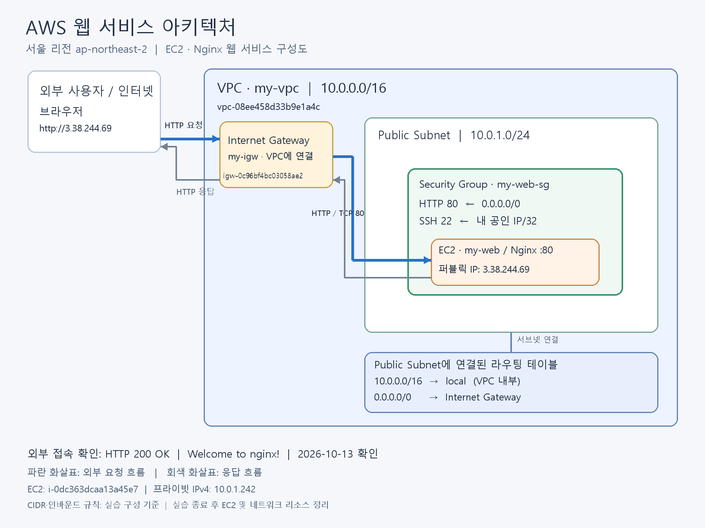
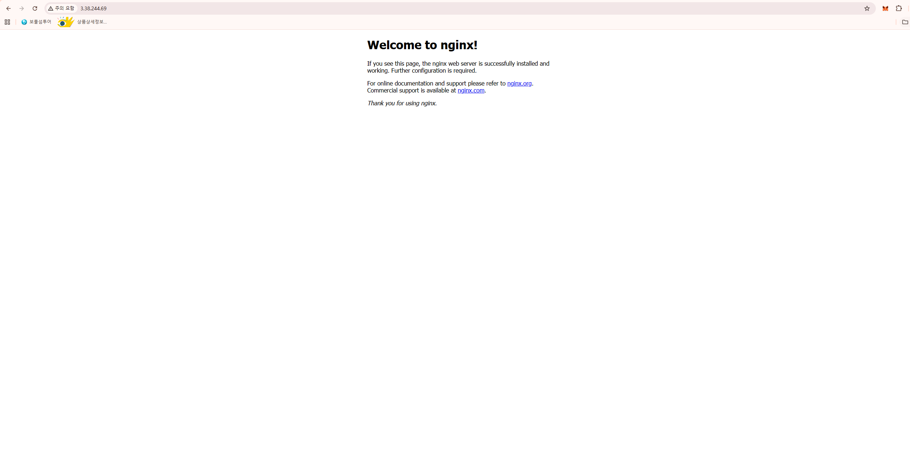

# AWS EC2 · Nginx 웹 서비스 구축 실습

## 실습 개요

AWS에 웹 서비스 환경을 구성하고 EC2에 Nginx를 설치하였다. SSH 접속, 웹 서버 실행 상태, 내부 HTTP 응답과 외부 브라우저 접속을 검증하였다. 검증 결과를 보관한 후 EC2 인스턴스를 종료하고 보안 그룹, 인터넷 게이트웨이 및 VPC를 삭제하였다.

## 실행 환경 및 리소스

| 항목 | 내용 |
|---|---|
| 리전 / 가용 영역 | 서울(ap-northeast-2) / ap-northeast-2a |
| EC2 이름 | my-web |
| 인스턴스 ID | i-0dc363dcaa13a45e7 |
| 인스턴스 유형 | t3.micro |
| 운영체제 | Ubuntu 26.04 LTS |
| 웹 서버 | Nginx 1.28.3 |
| 실습 당시 퍼블릭 IPv4 | 3.38.244.69 |
| 프라이빗 IPv4 | 10.0.1.242 |
| VPC | my-vpc / vpc-08ee458d33b9e1a4c |
| Internet Gateway | my-igw / igw-0c96bf4bc03058ae2 |
| Security Group | my-web-sg / sg-011cbf3e7068a214d |
| 키 페어 이름 | my-key |

서버 및 리소스 식별 정보는 터미널 기록과 첨부한 AWS 콘솔 화면을 기준으로 정리하였다. 아키텍처의 CIDR 및 인바운드 규칙은 실습 구성 기준으로 표시하였다.

## 1. 아키텍처 다이어그램



외부 HTTP 요청이 Internet Gateway를 통해 Public Subnet의 EC2·Nginx로 전달되고 응답이 반환되는 흐름을 표시하였다. 라우팅 테이블은 서브넷에 연결된 경로 규칙으로, Security Group은 EC2 접근 규칙으로 표현하였다.

### 네트워크 및 접근 제어 구성 요약

- VPC 구성 CIDR: `10.0.0.0/16`
- Public Subnet 구성 CIDR: `10.0.1.0/24`
- VPC 내부 경로: `10.0.0.0/16 → local`
- 인터넷 기본 경로: **`0.0.0.0/0 → igw-0c96bf4bc03058ae2`**
- 보안 그룹 구성 기준: **HTTP TCP 80 → 0.0.0.0/0**, **SSH TCP 22 → 학습자 공인 IPv4/32**
- 외부 접속 조건: **퍼블릭 IP 3.38.244.69 + 서브넷 인터넷 경로 + HTTP 허용 + Nginx 실행**

[네트워크·보안·IAM·운영 설계 설명](docs/network-security-operations.md)에 경로의 의미, 허용·차단 기준, 최소권한 설계와 비용 대응을 정리하였다. 구성 기준과 실제 설정 화면의 증빙 범위는 해당 문서에 구분하였다.

## 2. 웹 서버 설치 및 검증

Windows PowerShell에서 다음 명령으로 EC2의 Ubuntu 사용자에 접속하였다. 개인 키 경로는 개인정보를 제외하여 표시하였다.

```powershell
ssh -i "<개인 키 파일 경로>\my-key.pem" ubuntu@3.38.244.69
```

서버 내부 HTTP 응답 기록 시각은 한국 시간 **2026-10-13 00:22:53**, 반복 검증 시각은 **01:30:48**이다. SSH 접속 자체의 정확한 시작 시각은 별도 기록에 포함되어 있지 않다.

EC2 내부에서 다음 명령을 실행하였다.

```bash
sudo apt update
sudo apt install -y nginx
sudo systemctl enable --now nginx
systemctl status nginx --no-pager
curl -I http://localhost
```

확인 결과:

- Nginx 설치 완료
- 실행 상태: `active (running)`
- 부팅 시 자동 시작: `enabled`
- 내부 HTTP 응답: `HTTP/1.1 200 OK`

### 외부 접속 증빙

- 검증 방식: **(A) 브라우저 접속**
- 접속 URL: **http://3.38.244.69**
- 결과: **Welcome to nginx!** 페이지 표시



외부 접속 성공 화면과 서버 내부의 정상 응답을 통해 웹 서비스 동작을 확인하였다. 실습 종료 후 인스턴스를 종료했으므로 위 URL은 실습 당시의 접속 주소이다.

[설치 및 접속 검증 기록](docs/evidence-summary.md)

### 검증 방식 선택 근거

원 과제의 외부 접속 요구사항은 **(A) 브라우저 접속 또는 (B) GET /health 중 하나를 선택**하는 것이다. 본 실습은 A를 선택하고 접속 URL과 스크린샷을 제시하였다. 따라서 `/health` 결과가 없는 것은 선택하지 않은 B 방식의 미수행이며, 원 과제에서 A와 B를 모두 요구한 것은 아니다.

## 3. 트러블슈팅

SSH 접속 과정에서 발생한 `UNPROTECTED PRIVATE KEY FILE` 경고를 분석하였다. 서버 지문 확인 기록을 통해 SSH 서버 도달 여부를 구분하고, 개인 키 파일 권한을 중심으로 해결 절차를 정리하였다. 이후 Ubuntu 로그인과 Nginx 설치·접속 성공 결과를 기록하였다.

[트러블슈팅 보고서](docs/troubleshooting.md)

## 4. 리소스 정리

EC2가 종료된 것을 확인한 후 사용자 지정 보안 그룹을 삭제하였다. 인터넷 게이트웨이를 VPC에서 분리하고 삭제한 뒤 VPC를 삭제하였다. 각 단계의 완료 메시지와 리소스 목록을 증빙으로 보관하였다.

[리소스 정리 기록 및 체크리스트](docs/cleanup-checklist.md)

## 제출 파일 구성

```text
README.md
.gitignore
docs/
  architecture.png
  evidence-summary.md
  troubleshooting.md
  cleanup-checklist.md
  network-security-operations.md
  evidence/
    browser-access.png
    ec2-terminating.png
    ec2-terminated.png
    security-group-deleted.png
    igw-detached.png
    igw-deleted.png
    vpc-deleted.png
```

개인 키 파일, 비밀번호 및 액세스 키는 저장소에 포함하지 않았다.


