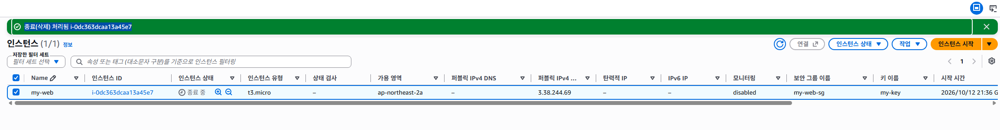
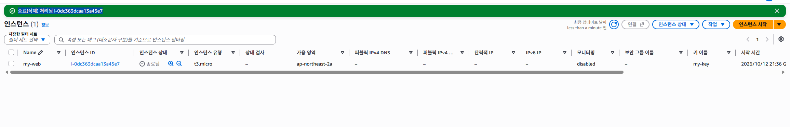
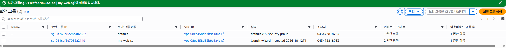
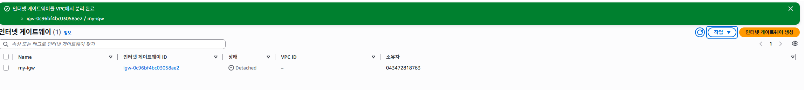
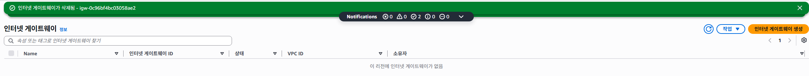
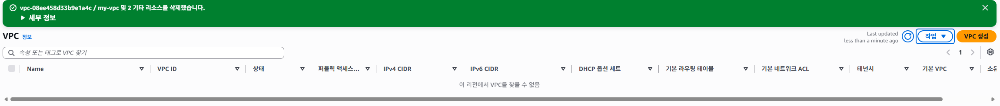

# 리소스 정리 기록 및 체크리스트

## 1. 정리 개요

웹 서비스 설치와 외부 접속 검증을 마친 뒤 실습 리소스를 정리하였다. EC2를 중지 상태로 남기지 않고 종료하였으며, 보안 그룹 삭제, 인터넷 게이트웨이 분리·삭제, VPC 삭제를 수행하였다.

기록 일자: **2026-10-13(한국 시간)**

## 2. 정리 결과

| 리소스 | 식별 정보 | 확인 결과 | 증빙 |
|---|---|---|---|
| EC2 | my-web / i-0dc363dcaa13a45e7 | 종료됨 | [종료 상태](evidence/ec2-terminated.png) |
| Security Group | my-web-sg / sg-011cbf3e7068a214d | 삭제 완료 메시지 확인 | [삭제 메시지](evidence/security-group-deleted.png) |
| Internet Gateway | my-igw / igw-0c96bf4bc03058ae2 | VPC 분리 완료, 이어서 삭제 완료 | [분리](evidence/igw-detached.png), [삭제](evidence/igw-deleted.png) |
| VPC | my-vpc / vpc-08ee458d33b9e1a4c | VPC 및 기타 리소스 2개 삭제 완료 메시지, VPC 목록 없음 | [삭제 결과](evidence/vpc-deleted.png) |

## 3. 완료 체크리스트

- [x] 외부 접속 결과와 설치·실행 기록을 보관하였다.
- [x] EC2 인스턴스의 종료됨 상태를 확인하였다.
- [x] 실습용 사용자 지정 보안 그룹의 삭제 완료 메시지를 확인하였다.
- [x] 인터넷 게이트웨이의 VPC 분리 및 Detached 상태를 확인하였다.
- [x] 인터넷 게이트웨이의 삭제 완료 메시지와 빈 목록을 확인하였다.
- [x] 실습 VPC의 삭제 완료 메시지와 빈 목록을 확인하였다.
- [x] 정리 결과 화면을 제출 자료에 보관하였다.

## 4. 단계별 증빙

### EC2 종료

종료 진행 화면에는 퍼블릭 IP `3.38.244.69`, 보안 그룹 `my-web-sg`, 키 페어 `my-key`가 표시되어 서비스 검증 대상과 종료 대상의 연결 관계를 확인할 수 있다.

후속 화면에서 인스턴스 상태가 **종료됨**으로 변경된 것을 확인하였다.

### 보안 그룹 삭제

상단 알림에서 `my-web-sg`의 삭제 완료를 확인하였다. 목록에 남아 보이는 행보다 작업 결과 알림을 삭제 증빙으로 사용하였다.

### 인터넷 게이트웨이 분리 및 삭제

VPC 분리 완료 메시지와 `Detached` 상태를 확인한 뒤 삭제하였다.

삭제 완료 메시지와 해당 리전에 인터넷 게이트웨이가 없는 목록을 확인하였다.

### VPC 삭제

`my-vpc` 및 기타 리소스 2개가 삭제되었다는 완료 메시지와 빈 VPC 목록을 확인하였다.

